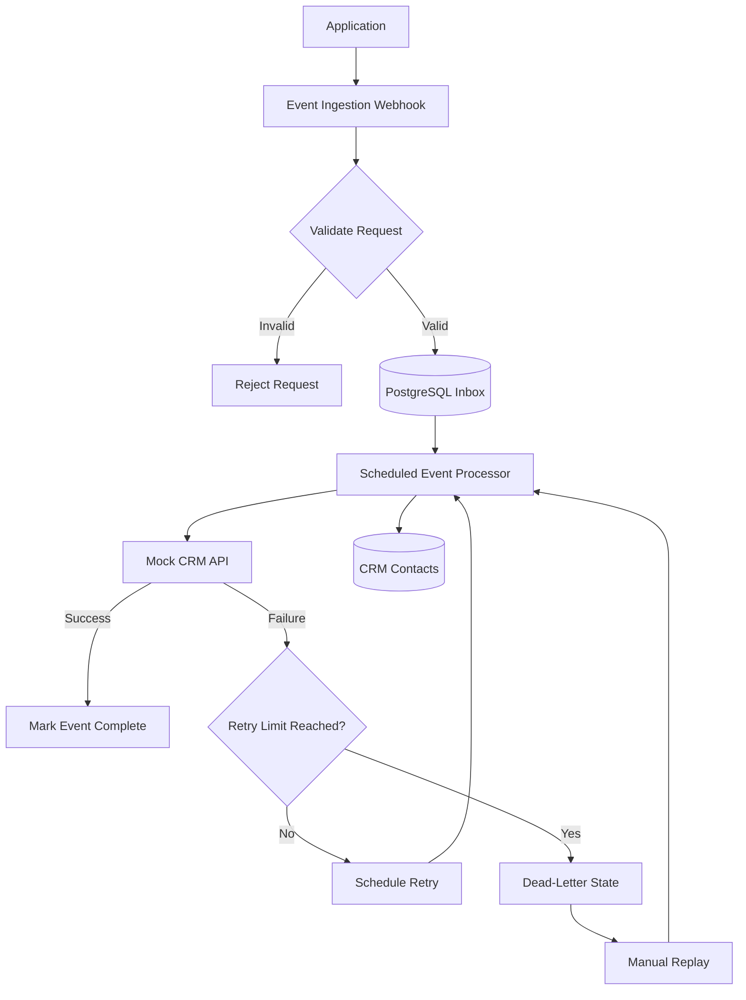

# Resilient Integration Layer

A self-hosted event integration system built with **n8n, Docker, and PostgreSQL**. It receives application events, stores them durably, and synchronizes them with a simulated CRM—even when the destination API fails.

The project demonstrates practical integration engineering concepts: **webhooks, HMAC signature verification, idempotency, retry policies, dead-letter handling, event replay, and operational monitoring.**

> **Status:** Local development project  
> **Cost:** Designed to run locally without paid APIs or subscriptions.

## What it does

| **Stage** | **Output** |
|---|---|
| **Receive** | Accepts application events through an n8n webhook |
| **Validate** | Checks required fields, timestamps, and request signatures |
| **Persist** | Stores incoming events in PostgreSQL before processing |
| **Deduplicate** | Uses unique event IDs to prevent duplicate event records |
| **Process** | Sends validated events to a simulated CRM endpoint |
| **Retry** | Reschedules failed events using a configurable backoff policy |
| **Recover** | Moves repeatedly failing events to a dead-letter state for investigation and replay |
| **Monitor** | Reports queue status, failures, and synchronization activity |

## Architecture

The system separates event ingestion from event processing so that receiving an event does not depend on the CRM being available.



Full design documentation: `docs/ARCHITECTURE.md` *(if included in the repository).*

## Why it is built this way

| **Principle** | **Implementation** |
|---|---|
| Durable ingestion | Persist events in PostgreSQL rather than relying only on an in-memory workflow execution |
| Idempotency | Enforce a unique constraint on `event_id` |
| Request verification | Use HMAC signature verification to help reject forged requests |
| Failure isolation | Process events separately from the ingestion webhook |
| Controlled retries | Track attempts and schedule future processing |
| Dead-letter handling | Retain repeatedly failing events for investigation |
| Recoverability | Support replaying events after the underlying issue is fixed |
| Observability | Track event statuses, errors, and processing activity |

## Stack

| **Layer** | **Technology** | **Purpose** |
|---|---|---|
| Workflow orchestration | n8n | Webhooks, scheduling, branching, and workflow execution |
| Infrastructure | Docker | Run the application services locally |
| Event storage | PostgreSQL | Durable inbox, event status, and retry metadata |
| CRM simulation | n8n Webhook + PostgreSQL | Simulate an external system that can fail |
| Email testing | Mailpit | Inspect locally generated email notifications |
| Request security | HMAC-SHA256 | Verify request authenticity |
| Testing | PowerShell / HTTP requests | Submit events and test failure scenarios |

## Workflows

| **Workflow** | **Responsibility** |
|---|---|
| `p2-01-event-ingest` | Receive, validate, and persist incoming events |
| `p2-02-event-processor` | Claim queued events, synchronize them, and manage retries |
| `p2-03-mock-crm-api` | Simulate a CRM endpoint and update contact records |
| `p2-04-event-simulator` | Generate test events, including duplicates and invalid requests |
| `p2-05-health-report` | Summarize event-processing health and failures |

*Workflow names and responsibilities should match the actual exported n8n workflows in the repository.*

## Event lifecycle

```text
received
   |
   v
processing
   |
   +---- Success ----------------> done
   |
   +---- Temporary failure -----> retry
   |                                |
   |                                v
   |                         processing again
   |
   +---- Retry limit reached --> dead
                                    |
                                    v
                              Manual replay
```

The intended retry policy uses exponential backoff, with a maximum of five attempts before an event is moved to the dead-letter state. The exact behavior depends on the configured workflow logic.

## Database design

The project uses a dedicated PostgreSQL database named `crm_sync`.

| **Table** | **Responsibility** |
|---|---|
| `events_inbox` | Stores event IDs, types, payloads, statuses, attempt counts, retry timestamps, and errors |
| `crm_contacts` | Stores the synchronized CRM contact records and their latest event references |

The unique `event_id` constraint protects against duplicate inbox records. The unique email constraint on `crm_contacts` supports contact upserts.

Schema: `database/integration-schema.sql`

## Repository layout

```text
resilient-integration-layer/
├── database/
│   └── integration-schema.sql
├── workflows/
│   ├── p2-01-event-ingest.json
│   ├── p2-02-event-processor.json
│   ├── p2-03-mock-crm-api.json
│   ├── p2-04-event-simulator.json
│   └── p2-05-health-report.json
├── docs/
│   ├── ARCHITECTURE.md
│   ├── SETUP.md
│   └── TESTING.md
├── .env.example
└── README.md
```

The layout above describes the intended repository organization; retain only files that actually exist.

## Quick start

### Prerequisites

- Docker Desktop
- A running n8n instance
- PostgreSQL running in Docker
- PowerShell on Windows

### 1. Create the database

If you are reusing the existing `job-radar-postgres` container, create a separate database for this project:

```powershell
docker exec -it job-radar-postgres psql -U jobradar -d postgres -c "CREATE DATABASE crm_sync;"
```

### 2. Apply the schema

From the project root:

```powershell
docker cp .\database\integration-schema.sql job-radar-postgres:/tmp/integration-schema.sql

docker exec -it job-radar-postgres psql -U jobradar -d crm_sync -f /tmp/integration-schema.sql
```

Verify the tables:

```powershell
docker exec -it job-radar-postgres psql -U jobradar -d crm_sync -c "\dt"
```

### 3. Configure n8n

Create a PostgreSQL credential for the project:

| **Setting** | **Value** |
|---|---|
| Host | `job-radar-postgres` |
| Port | `5432` |
| Database | `crm_sync` |
| User | `jobradar` |
| Password | Your existing PostgreSQL password |
| SSL | Disabled for local development |

Ensure n8n and PostgreSQL can communicate over their Docker network.

### 4. Import the workflows

1. Open `http://localhost:5678`.
2. Import the JSON files from `workflows/`.
3. Reconnect PostgreSQL credentials and review webhook paths.
4. Confirm the retry limits, signature secret, and error-handling branches.
5. Activate the workflows that use production webhook URLs.

### 5. Test the integration

Use the event simulator or send HTTP POST requests to the appropriate webhook.

Test the following scenarios:

- A valid event is stored and processed.
- Sending the same event ID twice does not create duplicate inbox records.
- An invalid signature is rejected.
- A temporary CRM failure triggers a retry.
- Repeated failures reach the dead-letter state.
- A failed event can be replayed after the simulated CRM is restored.

See `docs/SETUP.md` and `docs/TESTING.md` for detailed instructions, if those files are present.

## Local development URLs

| **Service** | **URL** |
|---|---|
| n8n | `http://localhost:5678` |
| Mailpit | `http://localhost:8025` |

## Known limitations

- The CRM is simulated; this is not an integration with a real CRM provider.
- The system is designed for local development, not production deployment.
- HMAC verification requires the sender and receiver to agree on the exact signature algorithm, secret, and message format.
- Event deduplication does not automatically guarantee exactly-once side effects in an external system.
- Concurrent processing, crash recovery, and replay behavior must be verified against the actual workflow configuration.
- Monitoring and email reporting depend on the corresponding workflows being configured and activated.

## Future improvements

- Add automated integration tests for success and failure paths.
- Add a dedicated event replay endpoint with safeguards.
- Implement atomic event claiming for concurrent workers.
- Add structured logs, metrics, and processing-latency measurements.
- Replace the simulated CRM with a real CRM API.
- Add CI validation for exported n8n workflow JSON files.

## License

MIT — add a `LICENSE` file if you intend to distribute the project under this license.
